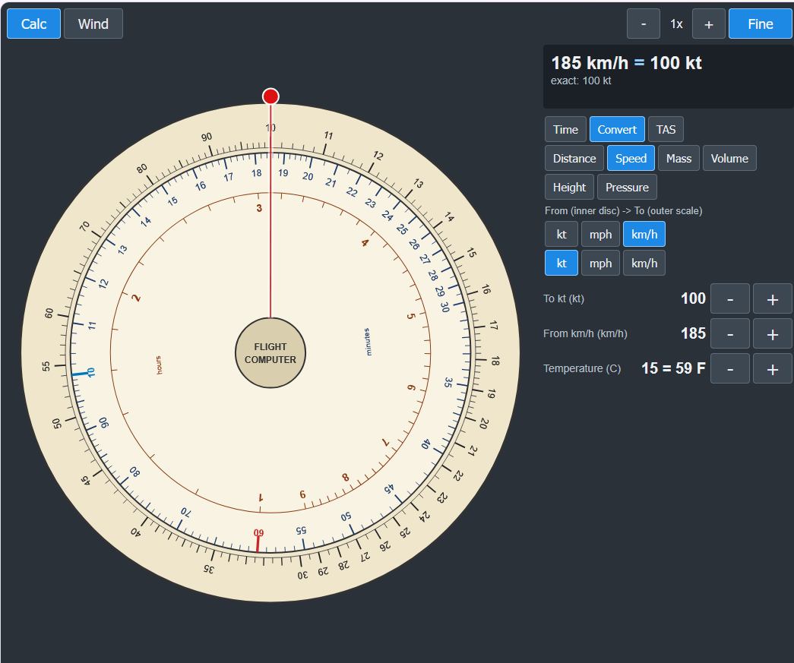
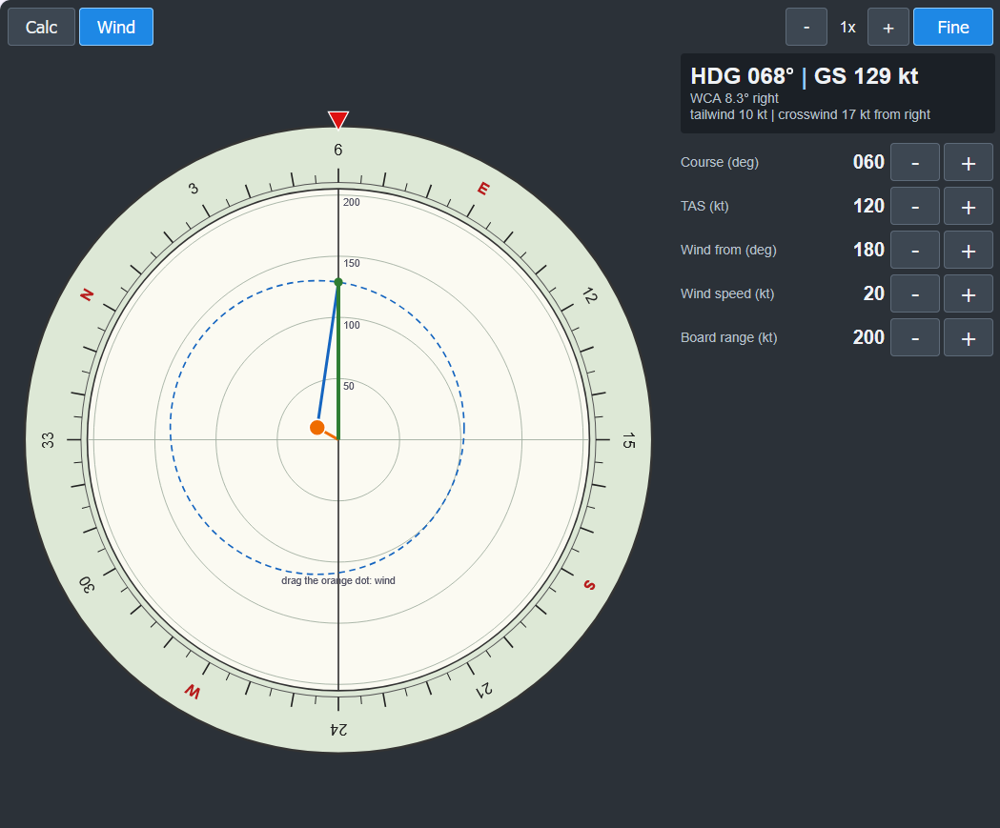

# MSFS Analog Flight Computer

A circular, E6B-style flight computer for the MSFS toolbar, built to be used with a mouse in VR.
Target: MSFS 2024 (the panel is still a classic toolbar in-game panel).

The base is provided by https://github.com/bymaximus/msfs2020-toolbar-window-template

## Principles

This flight computer attempts to keep the spirit of the actual implements, while being reasonably usable in VR. It means it's quite simplified, in particular for wind course correction and **TAS** computation.

## Faces

**Calc** - fixed outer scale, rotating inner disc, hairline cursor. The disc always obeys
`outer = inner x ratio`; the mode only picks the ratio.
- *Time*: speed / distance / time. Put the red 60 under your ground speed, read distance on the outer scale and minutes (and h:min) on the inner one.
- *Convert*: NM/SM/km, kt/mph/km/h, kg/lb, L/US gal/Imp gal, ft/m, hPa/inHg (plus a C/F stepper). Picking the units turns the disc for you.
- *TAS*: set pressure altitude and OAT; the disc turns to TAS/CAS. Exact TAS, Mach and density altitude are shown below the analog reading.

**Wind** - rotating compass ring (course under the red index) and a course-up plotting board. Drag the orange dot to set the wind; the dashed circle (radius TAS) around it cuts the track axis at the ground speed, and the blue line gives the wind correction angle.

## Controls (VR friendly)
- Drag the inner disc, the outer ring (hairline / compass ring) or the board with the mouse.
- Mouse wheel for fine adjustment, `+` / `-` buttons for every value (hold to repeat), `Coarse`/`Fine` switches the step size.
- Zoom buttons: the view follows the hairline (or the wind dot), so graduations stay readable on a small panel.
- State (discs, mode, zoom, wind) is remembered between sessions.

## Workflow

The `.bat` files use paths relative to their own location. The only machine-specific values are:
- `FC_COMMUNITY`: your MSFS `Community` folder. `deploy.bat` defaults to my own path (near the top of the file), so edit that line or set the environment variable.
- `MSFS_SDK`: the SDK folder, only needed by `build.bat` (the SDK installer sets it).

- `flight-computer-panel/` is the MSFS package. The code lives in `html_ui/InGamePanels/FlightComputerPanel/fc/`: `core.js` (pure maths), `units.js`, `scales.js`, `app.js` (shell), `face-calc.js`, `face-wind.js`.
- Test without MSFS: serve this folder over http (`python -m http.server 8765`) and open `dev/index.html` (the computer) or `dev/test.html` (maths tests, the title says PASSED or FAILED).
- `deploy.bat stage` builds `dist\flight-computer-panel` (without `Build\`, with a fresh `layout.json` from `MSFSLayoutGenerator.exe`). `deploy.bat` also copies it to the Community folder (`FC_COMMUNITY`, default set in `deploy.bat`).
- If you change the panel definition (size, icon...), rebuild the SPB with `build.bat` (needs `MSFS_SDK`), it copies the result to `flight-computer-panel\InGamePanels`.

## Screenshots

## History

- I had written a preliminary version of this flight computer in JS, and leave it as is for a while. Then, I asked Claude to finish the job and it did great.

## About the bymaximus package

I have started working on this flight computer using a generic template for MSFS plugin by [Maximus](https://github.com/bymaximus/msfs2020-toolbar-window-template). You can go to the linked site and make a donation to him if you are happy with this plugin. 
